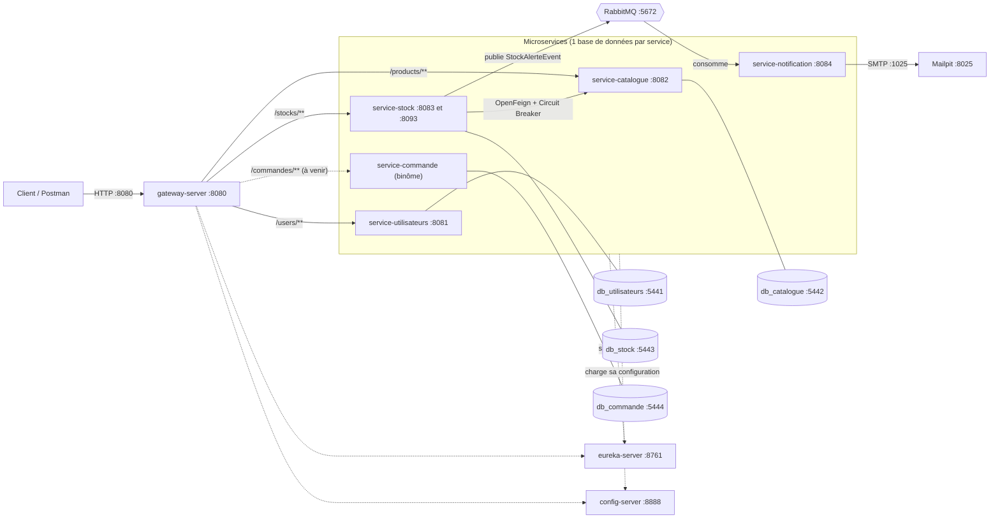
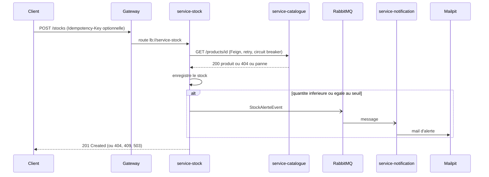
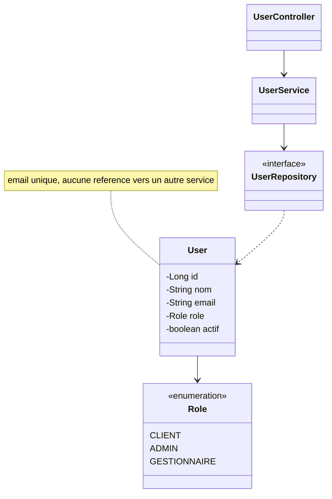
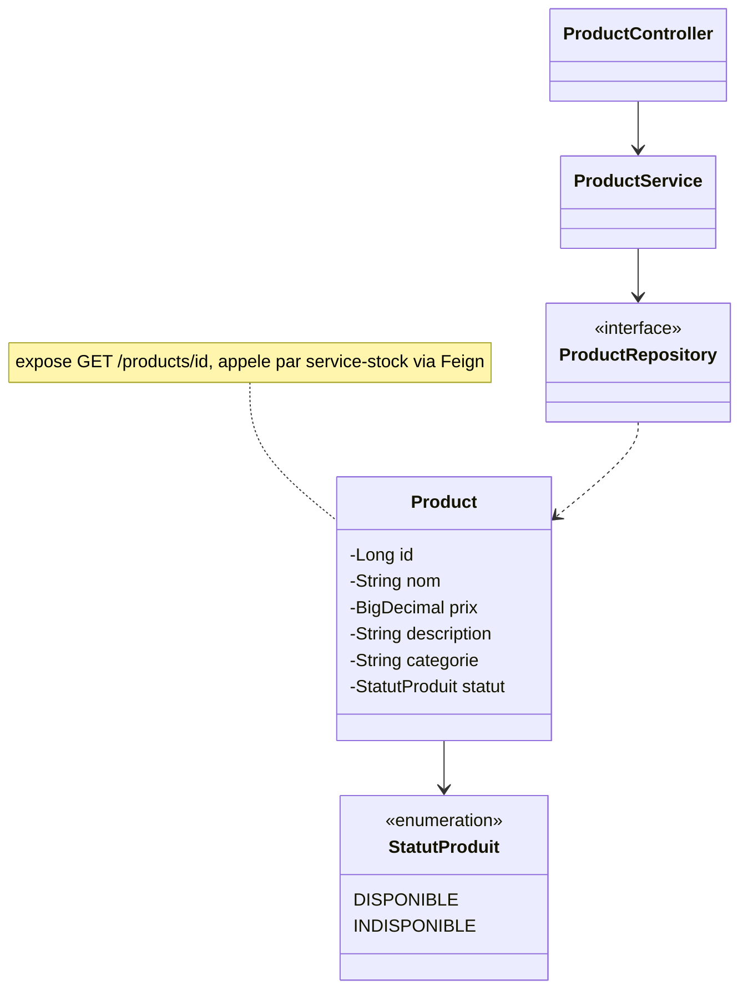
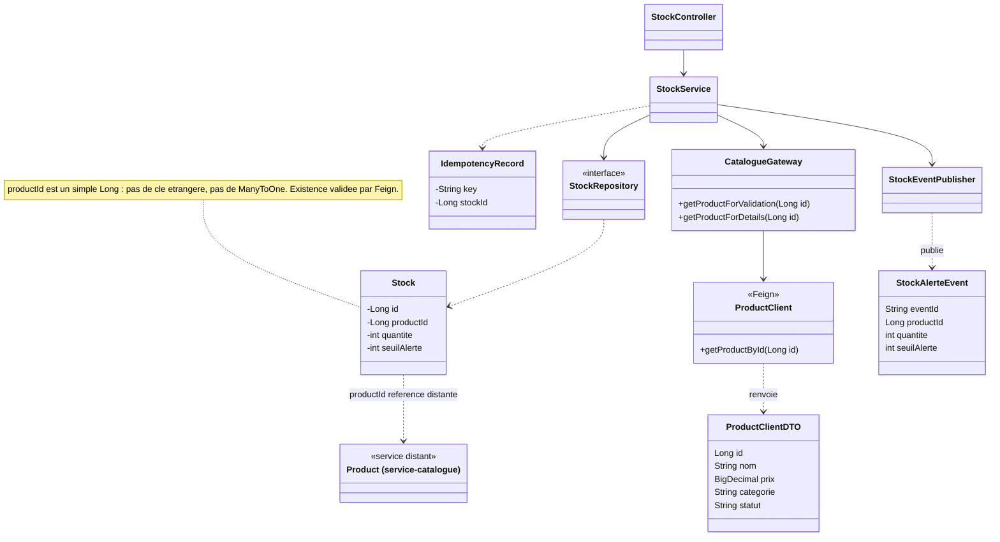
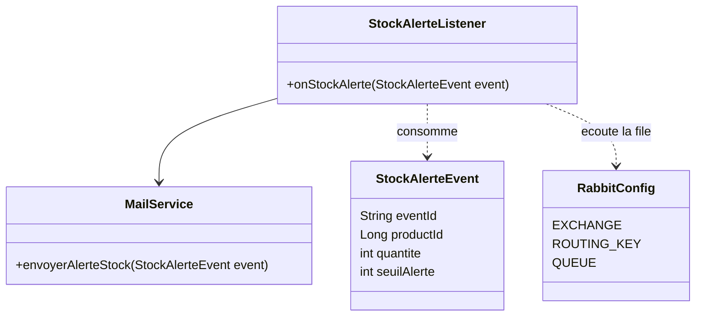
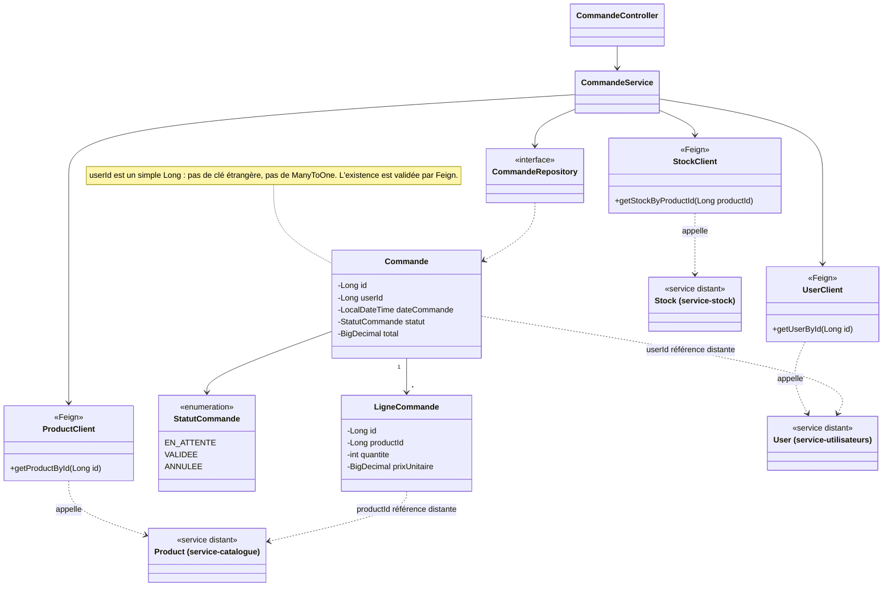

# Commande Express : architecture microservices

Plateforme de commande en ligne en microservices (Spring Boot, Spring Cloud) : utilisateurs, catalogue, stocks, notifications et commandes.

**Équipe** : <rabi meryem > <soumaya rizaoui > <monia hamdaoui>
**Dépôt** : <https://github.com/mounia-beep/Commande_Express.git>

## Sommaire
1. Architecture globale
2. Prérequis
3. Installation et lancement
4. Configuration centralisée
5. API Gateway
6. API par service
7. Diagrammes de classes et références distantes
8. Communication synchrone (OpenFeign)
9. Communication asynchrone (RabbitMQ)
10. Résilience et idempotence
11. Gestion des erreurs
12. Tests Postman


---

## 1. Architecture globale

### Services, ports et bases

| Module | Port | Rôle | Base de données |
|---|---|---|---|
| eureka-server | 8761 | Annuaire des services (Service Discovery) | aucune |
| config-server | 8888 | Configuration externalisée (`config-repo`) | aucune |
| gateway-server | 8080 | Point d'entrée unique, routage et load balancing | aucune |
| service-utilisateurs | 8081 | Gestion des utilisateurs | `db_utilisateurs` (5441) |
| service-catalogue | 8082 | Gestion des produits | `db_catalogue` (5442) |
| service-stock | 8083 (+ 8093) | Gestion des stocks, alertes | `db_stock` (5443) |
| service-notification | 8084 | Envoi des mails d'alerte | aucune |
| service-commande | (binôme) | Gestion des commandes | `db_commande` (5444) |
| RabbitMQ | 5672 / 15672 | Broker de messages (interface web : 15672) | n/a |
| Mailpit | 1025 / 8025 | Faux serveur de mail (interface web : 8025) | n/a |

**Database per Service** : chaque service possède sa base PostgreSQL, aucun accès croisé. Les services ne communiquent que par API (Feign) ou par messages (RabbitMQ).

### Parcours d'une création de stock



---

## 2. Prérequis

| Outil | Version |
|---|---|
| JDK | 21 |
| Maven | 3.9 ou plus (ou utiliser l'IDE) |
| Docker Desktop (Compose v2) | récent |
| Postman | récent |
| IntelliJ IDEA | recommandé |

Ports libres : 8080 à 8084, 8093, 8761, 8888, 5441 à 5444, 5672, 15672, 1025, 8025.

---

## 3. Installation et lancement

```bash
git clone <URL du dépôt>
cd Commande_Express
docker compose up -d
```

`docker compose ps` doit montrer les 4 bases PostgreSQL, `rabbitmq` et `mailpit` en *running*.

### Ordre de démarrage (important)

| # | Module | Pourquoi dans cet ordre |
|---|---|---|
| 1 | `eureka-server` | l'annuaire doit exister |
| 2 | `config-server` | les services y chargent leur configuration |
| 3 | `service-utilisateurs`, `service-catalogue` | |
| 4 | `service-notification` | il crée la file RabbitMQ avant que le stock publie |
| 5 | `service-stock` (8083) | |
| 6 | `gateway-server` | il a besoin d'Eureka |

Dans IntelliJ : lancer chaque classe `*Application`. En ligne de commande :

```bash
mvn -pl service-stock spring-boot:run
```

### Deuxième instance de `service-stock` (load balancing)

IntelliJ : nouvelle configuration *Spring Boot* sur `ServiceStockApplication`, avec *Program arguments* `--server.port=8093`.
Ligne de commande :

```bash
mvn -pl service-stock spring-boot:run "-Dspring-boot.run.arguments=--server.port=8093"
```

### Vérifications

| URL | Attendu |
|---|---|
| http://localhost:8761 | 5 à 6 applications en **UP**, `SERVICE-STOCK` avec 2 instances |
| http://localhost:15672 (guest / guest) | file `notification.stock-alerte.queue` avec 1 consumer |
| http://localhost:8025 | interface Mailpit |

Réinitialiser les bases (**efface toutes les données**) : `docker compose down -v` puis `docker compose up -d`.

---

## 4. Configuration centralisée (Config Server)

Chaque service ne contient qu'un `application.yaml` minimal :

```yaml
spring:
  application:
    name: service-stock
  config:
    import: "configserver:http://localhost:8888"
```

Le reste est dans `config-server/src/main/resources/config-repo/`. Le nom du fichier est **identique** à `spring.application.name`.

| Fichier | Contenu |
|---|---|
| `gateway-server.yaml` | port 8080, routes |
| `service-utilisateurs.yaml` | port 8081, base, Eureka |
| `service-catalogue.yaml` | port 8082, base, Eureka |
| `service-stock.yaml` | port 8083, base, RabbitMQ, timeouts Feign, circuit breakers |
| `service-notification.yaml` | port 8084, RabbitMQ, Mailpit, expéditeur et destinataire |
| `service-commande.yaml` | (binôme) |

⚠️ Après toute modification de `config-repo` : **redémarrer le Config Server**, puis le service concerné.

---

## 5. API Gateway

| Chemin | Service cible |
|---|---|
| `/users/**` | `lb://service-utilisateurs` |
| `/products/**` | `lb://service-catalogue` |
| `/stocks/**` | `lb://service-stock` |
| `/commandes/**` | (binôme, à ajouter) |

`lb://` signifie que la Gateway interroge Eureka et répartit les requêtes entre les instances (load balancing). Preuve : `GET http://localhost:8080/stocks/instance` répond tantôt « port 8083 », tantôt « port 8093 ».

---

## 6. API par service

Tous les appels passent par la Gateway (`:8080`). Pour tester un service seul, utiliser son port.

### Utilisateurs : `/users`

| Méthode | Chemin | Succès | Erreurs |
|---|---|---|---|
| POST | `/users` | 201 | 400, 409 (email déjà utilisé) |
| GET | `/users` | 200 | |
| GET | `/users/{id}` | 200 | 404, 400 |
| PUT | `/users/{id}` | 200 | 400, 404, 409 |
| DELETE | `/users/{id}` | 204 | 404 |

Règles : `nom` non vide, `email` valide et unique, `role` dans {CLIENT, ADMIN, GESTIONNAIRE}, `actif` facultatif (vrai par défaut).

### Catalogue : `/products`

Mêmes opérations que ci-dessus, plus le filtre `GET /products?categorie=...`.
Règles : `nom` non vide et unique (insensible à la casse), `prix` > 0, `statut` facultatif (DISPONIBLE par défaut, ou INDISPONIBLE).

### Stock : `/stocks`

| Méthode | Chemin | Succès | Erreurs |
|---|---|---|---|
| POST | `/stocks` (en-tête facultatif `Idempotency-Key`) | 201, ou 200 si rejeu | 400, 404 (produit inconnu), 409, 503 |
| GET | `/stocks` | 200 | |
| GET | `/stocks/{id}` | 200 | 404 |
| GET | `/stocks/product/{productId}` | 200 | 404 |
| GET | `/stocks/product/{productId}/details` | 200 (stock + produit) | 404 |
| PUT | `/stocks/{id}` | 200 | 400, 404, 409, 503 |
| DELETE | `/stocks/{id}` | 204 | 404 |
| GET | `/stocks/instance` | 200 (port de l'instance, démo du load balancing) | |

Règles : `productId` obligatoire et unique, `quantite` ≥ 0, `seuilAlerte` ≥ 0.

### Notification
Aucune API : le service consomme des messages RabbitMQ.

### Commande
(à compléter par la binôme)

---

## 7. Diagrammes de classes et références distantes

**Référence distante** : un service ne contient jamais la clé étrangère ni l'entité d'un autre service. Il garde seulement l'**identifiant** et valide son existence par un appel Feign. Il n'y a donc pas de `@ManyToOne` entre services.

| Service | Référence | Vers | Gestion |
|---|---|---|---|
| service-stock | `Stock.productId` | `Product` (service-catalogue) | simple `Long`, validée par Feign à la création et à la modification |
| service-notification | `productId` dans `StockAlerteEvent` | `Product` | simple identifiant dans le message |
| service-commande | (binôme) | utilisateur, produit | à compléter |

### service-utilisateurs



### service-catalogue



### service-stock



### service-notification



### service-commande
### service-commande



## 8. Communication synchrone (OpenFeign)

`service-stock` interroge `service-catalogue` par un client Feign fortement typé : interface `ProductClient` et DTO dédié `ProductClientDTO`. Le service est trouvé par son nom Eureka (`service-catalogue`).

| Cas d'usage | Comportement |
|---|---|
| **Validation préalable** : création ou modification d'un stock | produit absent : **404**, aucun stock créé. Catalogue indisponible : **503** |
| **Consultation enrichie** : `GET /stocks/product/{id}/details` | renvoie un DTO composé (stock + produit) |

---

## 9. Communication asynchrone (RabbitMQ)

| Élément | Valeur |
|---|---|
| Événement métier | stock bas : `quantite <= seuilAlerte` (à la création ou à la modification) |
| Publisher | `StockEventPublisher` (service-stock) |
| Exchange | `stock.exchange` (direct) |
| Routing key | `stock.alerte` |
| Queue | `notification.stock-alerte.queue` (durable) |
| Consumer | `StockAlerteListener` (service-notification) |
| Message | `StockAlerteEvent(eventId, productId, quantite, seuilAlerte)`, au format JSON |
| Résultat | mail « Alerte stock bas » reçu dans Mailpit |

Le stock ne dépend pas de la disponibilité du service de notification : si celui-ci est arrêté, le message attend dans la file.

---

## 10. Résilience et idempotence

### Appels Feign protégés (service-stock)

| Appel | Breaker | Si le catalogue est KO |
|---|---|---|
| Validation (création, modification) | `catalogue-validation` | 503, refus |
| Consultation `/details` | `catalogue-details` | mode dégradé : 200 avec `"produit": null` |

| Mécanisme | Réglage (`service-stock.yaml`) |
|---|---|
| Timeout Feign | connexion 1000 ms, lecture 1500 ms |
| Retry | 3 tentatives (erreurs réseau), pause 200 ms |
| Circuit Breaker | fenêtre de 6 appels, minimum 3, ouverture à 50 % d'échecs, ouvert 10 s |
| Timeout global | 6 s |

Un 404 du catalogue est une réponse valide : il ne compte pas comme un échec.

### Idempotence des créations

`POST /stocks` accepte l'en-tête `Idempotency-Key`. Première requête : **201**. Même clé rejouée : **200** avec le même stock et l'en-tête `Idempotent-Replayed: true`, rien n'est recréé. Sans clé, un doublon renvoie **409** (contrainte d'unicité).
Côté notification, l'`eventId` évite d'envoyer deux fois le mail pour un même message.

---

## 11. Gestion des erreurs

Chaque service possède un `@RestControllerAdvice` central. Format unique :

```json
{
  "timestamp": "2026-11-21T10:15:30",
  "status": 404,
  "error": "Not Found",
  "message": "Produit introuvable dans le catalogue : 9999",
  "details": null
}
```

| Code | Cas |
|---|---|
| 400 | validation, JSON illisible, paramètre invalide |
| 404 | ressource ou route introuvable |
| 405 | méthode HTTP non supportée |
| 409 | doublon, conflit d'unicité |
| 500 | erreur inattendue |
| 503 | service distant indisponible |

---

## 12. Tests Postman

Les collections sont dans le dossier `postman/` (Postman → **Import** → sélectionner les fichiers `.json`). Chaque requête porte dans son nom le code attendu (par exemple `[201] Créer un produit`) et un script de collection vérifie automatiquement le statut.

| Collection | Contenu |
|---|---|
| `service-utilisateurs` | CRUD utilisateurs (V1), variable `baseUrl` = `http://localhost:8081` |
| `Catalogue` | CRUD produits (V1) |
| `stock` | CRUD stocks (V1), nécessite les produits 1 et 2 dans le catalogue |
| `Gateway` | routage via `:8080`, load balancing, route inconnue |
| `Feign` | V4 (Feign), V5 (notification), V6 (résilience, idempotence) |

Ordre conseillé : Utilisateurs, Catalogue, Stock, Gateway, Feign. Pour rejouer les trois premières : repartir de bases vides.

---

## 13. Scénarios de démonstration

| Scénario | Étapes | Preuve |
|---|---|---|
| Service Discovery | ouvrir `:8761` | toutes les instances en UP |
| Load balancing | 6 × `GET :8080/stocks/instance` | alternance 8083 / 8093 |
| Validation Feign | `POST /stocks` avec `productId` 9999 | 404, aucun stock créé |
| Agrégation | `GET /stocks/product/{id}/details` | DTO stock + produit |
| Cycle asynchrone | `PUT` d'un stock sous son seuil | logs publisher et consumer, mail dans Mailpit |
| Asynchrone et panne | arrêter la notification, refaire le `PUT` | 200 côté stock, message en attente dans la file |
| Circuit breaker | arrêter le catalogue, `POST /stocks` ×4 | 503, puis réponse immédiate quand le circuit est ouvert |
| Mode dégradé | catalogue arrêté, `GET .../details` | 200 avec `produit: null` |
| Idempotence | `POST /stocks` deux fois avec la même clé | 201 puis 200, même `id` |

Captures dans `docs/` :


---

## 14. Structure du dépôt

```
Commande_Express/
├── config-server/          # + src/main/resources/config-repo/*.yaml
├── eureka-server/
├── gateway-server/
├── service-utilisateurs/
├── service-catalogue/
├── service-stock/
├── service-notification/
├── service-commande/       # (binôme)
├── postman/                # collections exportées
├── docs/                   # captures d'écran
├── docker-compose.yml      # PostgreSQL ×4, RabbitMQ, Mailpit
├── pom.xml                 # parent multi-modules
└── README.md
```

---

## 15. Limites connues

- Supprimer un produit du catalogue ne supprime pas son stock (pas de cascade entre services).
- Si RabbitMQ est arrêté au moment du `PUT`, l'alerte est perdue (la mise à jour du stock réussit quand même).
- Une alerte part à chaque mise à jour d'un stock déjà bas.
- L'anti-doublon des événements est en mémoire : perdu au redémarrage de la notification.
- Si le mail échoue, le message n'est pas rejoué.

## 16. Dépannage

| Symptôme | Cause et solution |
|---|---|
| 503 de la Gateway juste après un démarrage | la Gateway rafraîchit son annuaire toutes les 30 s : attendre 30 à 60 s |
| Une modification de `config-repo` n'est pas prise en compte | redémarrer le Config Server, puis le service |
| `Cannot determine local hostname` | avertissement Windows sans gravité |
| Pas de file dans RabbitMQ | `service-notification` non lancé, ou classes hors du package scanné par `@SpringBootApplication` |
| Erreur `port already in use` | un ancien processus tourne encore (`netstat -ano \| findstr :8083`) |
| Mailpit vide | vérifier les logs « Événement reçu » et « Mail envoyé » de `service-notification` |
